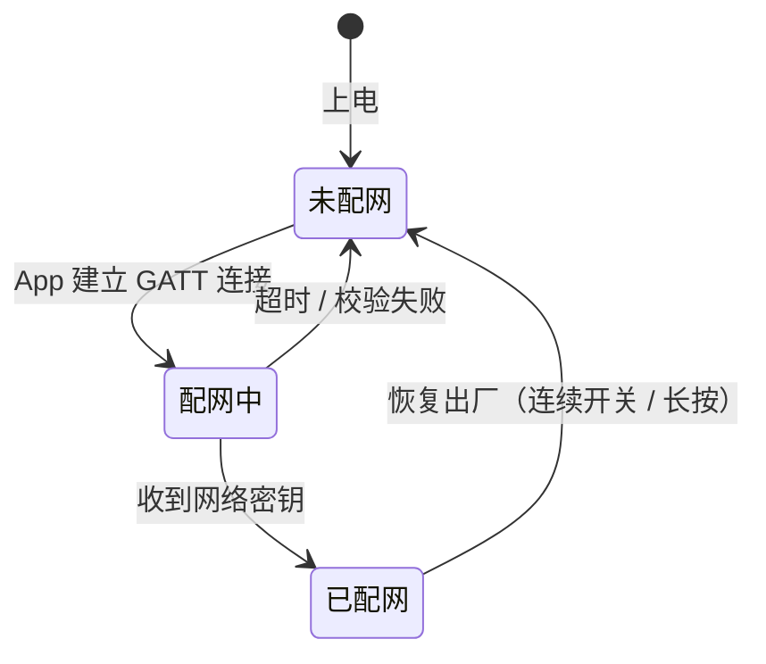
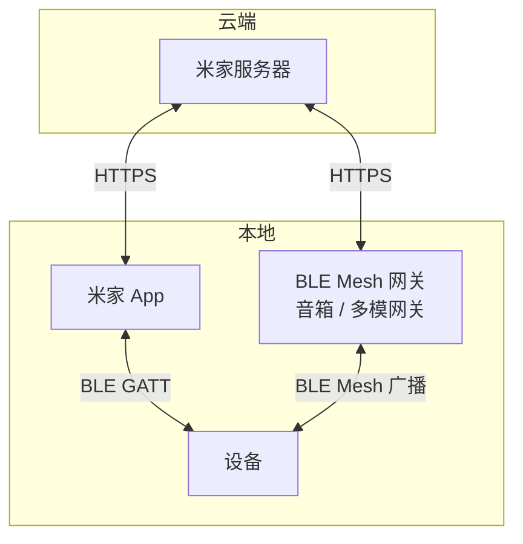

# 01 整体架构

## 设备生命周期

米家 BLE Mesh 设备在生命周期里只有三种状态，三种状态用的通信方式完全不同：



| 状态 | 广播内容 | 是否可被 App 连接 | 通信层 |
|---|---|---|---|
| 未配网 | MiBeacon，带"需要配网"标志 | 是 | GATT |
| 配网中 | 停止广播（被连接占用） | 已连接 | GATT |
| 已配网 | Mesh Beacon / 关闭广播 | 否（GATT 关闭） | BLE Mesh 广播承载 |

关键点：**已配网的设备不再开放配网 GATT 服务**。所以一个设备一旦入网，就没有第二次机会通过 GATT 观察它的配网流程 —— 要复现必须恢复出厂。

## 三层通信结构



两条完全不同的路径：

1. **配网路径**：App 直连设备，走 BLE GATT，链路经过云端做身份认证。每个数据包都要 App 转发到服务器，服务器判完再告诉 App 下一步。
2. **运行路径**：云端 → 网关 → mesh 广播 → 设备。App 不在链路里，设备也不需要被连接。

这也解释了为什么配网必须手机贴近设备（GATT 直连），而日常控制可以远程（走网关）。

## 广播帧

未配网状态下设备持续广播 MiBeacon 帧，承载在标准 BLE 广播的 Service Data（0xFE95）里。

观察到的结构（按字节序）：

| 偏移 | 长度 | 内容 |
|---|---|---|
| 0 | 1 | 帧控制，配网态常见 `0x5A` |
| 1–2 | 2 | 产品 ID，小端 |
| 3 | 1 | 帧计数器，每帧递增 |
| 4–9 | 6 | 设备 MAC |
| 10– | 13 | mesh 状态段（含是否已注册、是否需要配网等标志） |

帧控制 `0x5A` 的位含义（按观察推断，公开资料一致）：

```
bit7..6  版本
bit5     需要加密
bit4     已配网标志（配网态为 0）
bit3     solicited（等待被连接）
bit2..0  保留
```

产品 ID 决定了 App 把它识别成什么设备，也是 App 选择配网模板的依据。不同产品 ID 的配网流程可能有细微差别，但主体框架一致。

## GATT 服务

配网态设备暴露一组私有 16 位 UUID 特征值（不是标准 Mesh Provisioning Service）：

| UUID | 方向 | 用途 |
|---|---|---|
| `0x0010` | 双向 | 控制通道：下发指令、回状态码 |
| `0x0016` | 双向 | 多帧数据通道：证书、密钥包等大块数据 |
| `0x0019` | 双向 | 辅助通道 |
| `0x001A` | 双向 | 辅助通道 |
| `0x001B` | 只读 | 版本 / 规格属性 |
| `0x001C` | 双向 | 明文命令通道：握手与能力查询 |

`0x001B` 对读请求返回 `Read Not Permitted`（ATT 0x02），说明它只用于内部逻辑，不是给外部读的。

App 连接后会**依次订阅** `0x0010`、`0x0016`、`0x0019`、`0x001A`、`0x001C` 的 CCCD，然后才开始握手。这个顺序是固定的。

## 谁在验证谁

整个配网过程是一次双向认证，但两端验的东西不一样：

| 验证方向 | 手段 | 谁执行 |
|---|---|---|
| 设备 → 服务器 | 设备验证服务器证书链 + 服务器签名 | 设备固件 |
| 服务器 → 设备 | 设备对服务器下发的随机挑战签名，服务器验证 | 服务器 |

**设备不自己验 App**，App 只是个搬运工：把设备证书搬给服务器、把服务器的包搬给设备、把设备的签名搬回服务器。所有判断都在服务器端做。

这一点很重要 —— 它意味着任何"本地伪装"都不成立，决定权在服务器。
