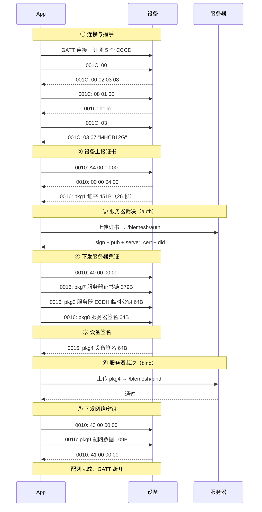

# 02 配网时序

## 总览

一次完整配网 = **3 轮握手 + 2 次云端裁决 + 1 次密钥下发**。全程约 15–25 秒，其中绝大部分时间花在服务器往返和多帧传输的帧间延时上。



## 包编号对照

同一个编号在上下行两个方向内容不同，容易混淆，先理清：

| 包号 | 方向 | 大小 | 内容 |
|---|---|---|---|
| `pkg1` | 设备 → App | 451B | 设备 X.509 证书（DER） |
| `pkg3` | 设备 → App | 84B | 12B 设备信息 + 8B 厂商证书 ID + 64B 设备 mesh 公钥 |
| `pkg7` | App → 设备 | 379B | 服务器证书链 |
| `pkg3` | App → 设备 | 64B | 服务器临时 ECDH 公钥 |
| `pkg8` | App → 设备 | 64B | 服务器签名 |
| `pkg4` | 设备 → App | 64B | 设备对挑战的 ECDSA 签名 |
| `pkg9` | App → 设备 | 109B | 配网数据（网络密钥等） |

`pkg3` 在两个方向都出现，但语义完全不同 —— 这是观察中最容易踩的坑。

## 第 ① 步：握手（001C）

`0x001C` 是明文通道，不走加密也不走多帧，一问一答：

| App 发 | 设备回 | 含义 |
|---|---|---|
| `00` | `00 02 03 08` | 查询协议版本 → 回复支持的版本位图 |
| `08 01 00` | `hello` | 存活探测 |
| `03` | `03 07 "MHCB12G"` | 查询模组型号 → 返回型号字符串 |

`08 01 00` 这个探测很实用：它是设备认可的"活着吗"，不产生任何业务流程副作用，可以用来维持或检测链路。

## 第 ② 步：上报证书（pkg1）

App 发 `A4 00 00 00` 触发，设备回 `00 00 04 00` 表示"我要发 4 号包的前置通知"，然后通过 `0x0016` 用多帧协议把 451 字节证书分成 26 帧送出。

## 第 ③ 步：auth

App 把证书原样上传服务器。服务器做三件事：

1. 验证书链是否由米家根证书签发
2. 从证书里取出设备公钥，存进这次配网会话
3. 生成会话材料返回给 App：`sign`、`pub`、`server_cert`、`did`

## 第 ④ 步：下发服务器凭证

三块数据依次送到设备：

- `pkg7` — 服务器证书链，设备用它验证服务器身份
- `pkg3` — 服务器临时 ECDH 公钥，设备拿它算共享密钥
- `pkg8` — 服务器对挑战的签名

设备在本地做两件事：验证书链是否可信、验 `pkg8` 的签名。

## 第 ⑤ 步：设备签名（pkg4）

设备通过验证后，用**自己的私钥**对挑战签名，产出 64 字节的 `pkg4`（r‖s 格式）。

这一步是整个流程的关键：**签名内容包含服务器生成的随机量**，所以每次配网产出的 `pkg4` 都不一样。

## 第 ⑥ 步：bind

App 把 `pkg4` 原样送到服务器。注意 **App 自己不做任何验签**，它只是搬运 —— 判断权完全在服务器。

服务器验证：`pkg4` 是否是用「第 ③ 步保存的设备公钥」对应的私钥签的。

## 第 ⑦ 步：下发网络密钥（pkg9）

验证通过后，App 发 `43 00 00 00` 作为前导，然后通过 `0x0016` 下发 109 字节配网数据，其中包含 mesh 网络的 `NetKey`、`AppKey`、分配的单播地址、IV Index 等。

设备收到后回 `41 00 00 00`，配网完成，GATT 断开，设备转入 mesh 节点状态。

## 多帧传输协议（0x0016）

大块数据靠一套简单的分片协议：

```
<seq> 00 <最多 18 字节 payload>
```

| 帧 | 内容 | 说明 |
|---|---|---|
| START | `00 00 00 <pkg> <n> 00` | 发起传输，`n` = 后续数据帧数 |
| ACK 开始 | `00 00 01 01` | 接收方同意开始 |
| 数据帧 | `<seq> 00 <payload>` | `seq` 从 1 递增，末帧可不足 18 字节 |
| ACK 完成 | `00 00 01 00` | 接收方确认收齐 |

关键细节：

- **帧间需要延时**。设备侧推送约 25–30ms 一帧，太快会把对端缓冲灌爆。
- **同一连接同一时刻只允许一个 GATT 过程**。写第一帧后必须等完成回调才能写下一帧，否则返回 `EBUSY` 并丢帧。
- **START 的 `n` 是帧数不是字节数**，容易看错。
- 传输完成后发 `00 00 01 00`，接收方才认为这一包有效。

## 设计意图

这套流程里有几个值得注意的设计选择：

1. **把判断权全部放服务器**。App 不做任何验签，只做搬运。这样 App 被逆向、被改包都不影响安全性 —— 反正服务器会重算一遍。
2. **挑战一次性**。`pkg8` 里的随机量来自服务器，每次不同，所以 `pkg4` 无法重放。
3. **设备只认证书链**。设备验证服务器凭证的完整性，不验证"这次配网是谁发起的" —— 它对"谁在配网"不关心，只关心"对面的服务器是不是真的"。
4. **密钥下发在认证之后**。`pkg9` 里的网络密钥用会话密钥加密，会话密钥由 ECDH 派生，所以只有通过认证的设备能解开。
