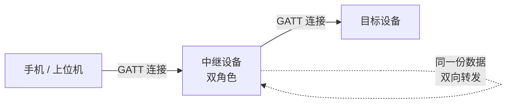

# 07 BLE 中继工程实践

这一节记录一个研究场景下踩到的工程问题：**如何在 ESP32（NimBLE）上做一个透明的 BLE 中继**——对外表现成一台外围设备，同时作为中心设备连接另一台设备，双向转发所有 GATT 数据。

这个组件本身与具体协议无关，任何需要"观察两台 BLE 设备完整交互"的场景都能用。

## 架构



中继需要同时扮演两个角色：

| 角色 | 对谁 | 需要什么 |
|---|---|---|
| Peripheral（外围） | 手机 | 广播、GATT 服务端、notify |
| Central（中心） | 目标设备 | 扫描/连接、服务发现、CCCD 订阅、写 |

NimBLE 允许同时做，但有几个默认配置会挡路。

## 问题一：地址冲突

如果为了让上层看到"目标设备的 MAC"，把中继的 public 地址改成目标设备的地址，那么中继作为 central 去连目标设备时，**目标设备会忽略来自相同地址的连接请求**（从设备认为这是自己）。

现象：连接请求超时，`status=13`。

### 解法：两个角色用不同地址

| 角色 | 地址类型 | 取值 |
|---|---|---|
| Peripheral（对外广播） | Public | 目标设备的 MAC |
| Central（连目标） | Random Static | 自己生成，与目标无关 |

```c
/* 中央角色用独立的随机静态地址 */
static const uint8_t RND_ADDR[6] = { 0xC0, 0x55, 0x44, 0x33, 0x22, 0x11 };
ble_hs_id_set_rnd(RND_ADDR);
```

地址的两个要求：

- 最高两 bit 必须是 `11`（Random Static 类型）
- 不能与任何真实设备冲突

## 问题二：设置随机地址的时机

`ble_hs_id_set_rnd()` 在**广播已启动**时调用会失败，返回 `524`（HCI `0x0C` Command Disallowed）。控制器在广播期间不允许修改地址。

### 解法

在 `ble_gap_adv_start()` **之前**设置。顺序必须是：

```c
ble_hs_id_set_rnd(RND_ADDR);   /* 先设地址 */
/* ... 配置 GATT 服务 ... */
ble_gap_adv_start(...);        /* 再开广播 */
```

注意 `ble_hs_id_set_rnd()` 设置的是**控制器地址**，对 Periphral 和 Central 都生效。如果 Peripheral 必须用 Public 地址、Central 用 Random，需要在启动 central 之前切换 —— 而 NimBLE 的 `ble_gap_connect(own_addr_type, ...)` 支持在连接时指定地址类型，不必改全局设置：

```c
ble_gap_connect(BLE_OWN_ADDR_RANDOM, &target, timeout, NULL, cb, NULL);
```

这样 Peripheral 继续用 Public 广播，Central 用 Random 连接，两者互不干扰。

## 问题三：写操作必须串行

BLE 同一连接同一时刻只允许一个 GATT 过程。连续调用写接口，第二个返回 `BLE_HS_EBUSY`，**数据直接丢失**。

在多帧协议里，丢一帧整包就废。

### 解法：单槽在途 + 环形队列

```c
#define Q_SLOTS 40
typedef struct { uint16_t uuid16; uint16_t len; uint8_t d[128]; } q_item_t;
static q_item_t s_q[Q_SLOTS];
static int s_head, s_tail, s_cnt;
static volatile int s_busy;      /* 有写操作在途 */

static void write_next(void)
{
    if (s_busy || s_cnt == 0) return;
    q_item_t *it = &s_q[s_tail];
    int rc = ble_gattc_write_flat(conn, handle_of(it->uuid16),
                                 it->d, it->len, write_done_cb, NULL);
    if (rc == 0) {
        s_busy = 1;                        /* 等回调再发下一帧 */
    } else if (rc == BLE_HS_EBUSY) {
        /* 不该发生（s_busy 已拦住），留日志排查 */
    } else {
        drop_and_advance();
    }
}

static int write_done_cb(uint16_t conn, const struct ble_gatt_error *e,
                         struct ble_gatt_attr *a, void *arg)
{
    s_busy = 0;
    advance_queue();
    write_next();                          /* 递归发下一帧 */
    return 0;
}
```

**关键点**：`ble_gattc_write_flat` 的回调发生在 NimBLE host task 里，不能在回调里阻塞等待，只能推进队列后立刻返回。

## 问题四：CCCD 订阅必须串行

想订阅多个特征值的通知时，一次性并发写 5 个 CCCD，后面的会返回 `BLE_HS_ENOMEM`（描述符写需要分配缓冲）。

### 解法：链式订阅

```c
static int s_sub_idx;

static void subscribe_next(void)
{
    if (s_sub_idx >= N_CHR) {
        ready();                           /* 全部订阅完成 */
        return;
    }
    ble_gattc_write_flat(conn, s_chr[s_sub_idx].cccd_handle,
                         (uint8_t[]){0x01, 0x00}, 2, sub_done_cb, NULL);
}

static int sub_done_cb(uint16_t c, const struct ble_gatt_error *e,
                       struct ble_gatt_attr *a, void *arg)
{
    if (e->status == 0) s_sub_idx++;
    subscribe_next();
    return 0;
}
```

`0x01 0x00` 是"通知使能"，`0x02 0x00` 是"指示使能"，两者都开用 `0x03 0x00`。

## 问题五：连接数上限

默认 `CONFIG_BT_NIMBLE_MAX_CONNECTIONS=1`，只够一个角色。同时做 Peripheral 和 Central 需要至少 2 个，建议 3。

```ini
CONFIG_BT_NIMBLE_MAX_CONNECTIONS=3
```

改完还要注意内存：`CONFIG_BT_NIMBLE_MSYS1_BLOCK_COUNT` 会限制并发操作数，广播启动失败返回 `6`（`ENOMEM`）通常就是这个不够。

## 问题六：连接生命周期管理

目标设备可能有自己的连接寿命限制（见 [05 实测观察](05-observations.md)）。如果中继开机就连上、然后空闲等待，等真正需要传输时窗口可能已经用掉大半。

### 关键设计：按需建链

```c
/* 不要在 init 里连目标设备 */
void on_upstream_connected(void)      /* 上游（手机）连上时 */
{
    reset_queue();
    if (link_age_ms() > 2000) {       /* 旧链路太老，砍掉重建 */
        ble_gap_terminate(target_conn, BLE_ERR_REM_USER_CONN_TERM);
        /* 断开事件里会立即重连 */
    } else if (target_conn == NONE) {
        connect_target();             /* 建链期间的帧先入队 */
    }
}

void on_upstream_disconnected(void)
{
    if (target_conn != NONE)
        ble_gap_terminate(target_conn, BLE_ERR_REM_USER_CONN_TERM);
}
```

配合"建链期间的帧不丢弃、先入队、就绪后补发"，才能保证上游看到的是一条连续的、没有空洞的链路。

## 问题七：notify 转发

从目标设备收到的 notify 要原样转给上游：

```c
case BLE_GAP_EVENT_NOTIFY_RX: {
    if (ev->notify_rx.conn_handle != target_conn) return 0;
    uint8_t buf[512];
    uint16_t got = 0;
    ble_hs_mbuf_to_flat(ev->notify_rx.om, buf, sizeof(buf), &got);

    uint16_t uuid16 = lookup_uuid(ev->notify_rx.attr_handle);
    gatts_notify(upstream_conn, uuid16, buf, got);   /* 转给上游 */
    return 0;
}
```

注意：`ble_hs_mbuf_to_flat` 之后 mbuf 仍然有效，但为了安全应立即拷贝，因为回调返回后 buffer 会被回收。

## 踩坑清单

| 现象 | 原因 | 修法 |
|---|---|---|
| 连不上目标（status 13） | 双方地址相同 | Central 用 Random Static |
| `ble_hs_id_set_rnd` 返回 524 | 广播已启动 | 移到 adv_start 之前 |
| 写帧丢失 | 并发写触发 EBUSY | 单槽在途 + 队列 |
| CCCD 写返回 ENOMEM | 并发分配描述符缓冲 | 链式串行订阅 |
| `adv_start` 返回 6 | 连接数/内存块不足 | 提高 MAX_CONNECTIONS 与 MSYS 块数 |
| 传输中途断开 | 目标有单连接寿命 | 按需建链 + 帧缓存补发 |
| 转发不完整 | mbuf 未及时拷贝 | 回调内立刻 flat 到本地 buffer |

## 一点经验

BLE 中继的难点不在"转发"，而在**时序**。两个连接各自有独立的状态机、独立的过程槽位、独立的超时，任何一个环节的等待都会在另一端表现为"卡住"。

调试时最有效的手段是**逐帧留痕**：每帧打方向、UUID、长度、前几字节，然后对照两端的日志看哪一帧没过去。这比读协议栈源码快得多。
